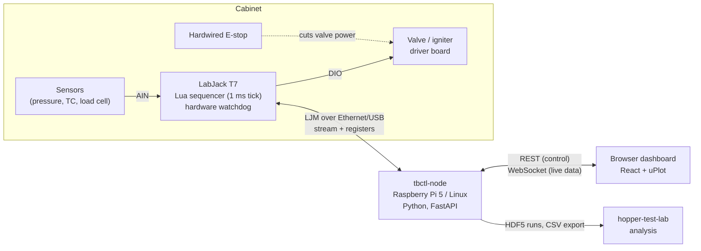

# Architecture

tbctl is the test bench and mission control software for the Hopper
programme (H2 lander, Aldenhoven test bench). It reads the sensors, drives
valves and igniters, runs firing sequences deterministically, records every
run, and hands the data to hopper-test-lab for analysis.

This page is the map. Details live in the code (module docstrings) and in
`docs/deployment.md`, `docs/hopper-test-lab.md` and `docs/timing-report.md`.

## System overview



There are three pieces of software:

| Piece | Where | What it does |
|---|---|---|
| **Lua sequencer** (`lua/`) | on the T7 | Executes the valve/igniter step table at a 1 ms tick, enforces the heartbeat and igniter guards, runs the abort table on its own. Frozen and generic: sequences are data, not code. |
| **Node** (`src/tbctl/`) | Pi / Linux server, one process | Streams and converts data, records runs, compiles and uploads sequences, publishes the heartbeat, serves the API and the built dashboard. |
| **Dashboard** (`frontend/`) | any browser on the bench LAN | Pure client: charts, P&ID, valve and sequence panels, editors for channels, sequences and the P&ID. Nothing safety-relevant runs here. |

## The node

One asyncio process, composed in `node.py`. Layers, top to bottom:

```
api/        rest.py (all control, ~50 endpoints)   ws.py (live frames, status, events)
services/   acquisition  recorder  sequencer  safety  redlines  manual_control
            device_manager  events  review  annotations  hopper  config_editor
config/     pydantic models for every YAML file, loader with SHA256 per file
hw/         DeviceInterface: LjmDevice (real T7) | MockDevice (simulator)
```

- **Device access.** Every service talks to one `SwitchableDevice`, which
  delegates to the current backend: simulator, USB or Ethernet, switchable
  at runtime (`device_manager.py`). LJM calls block, so async code runs them
  with `asyncio.to_thread`. On USB, calls are serialised behind the stream
  read, because concurrent command-response kills a USB stream.
- **The event loop is shared** by the acquisition loop, the 20 Hz heartbeat,
  the recorder flush and the API. Anything slow (disk, device I/O) stays off
  it, so the heartbeat is never starved.
- **Simulator parity.** `--sim` swaps in `MockDevice` and changes nothing
  else: streaming, recording, the full sequencer (simulated Lua) and manual
  valves behave as on hardware. `configs/sim.yaml` adds a simple chamber model.

## Data path

```
T7 stream ──► acquisition ──► ring buffers (per rate group) ──┬─► recorder ──► HDF5 (flush 0.5 s)
 (one scan     EU conversion,     window()/latest() read      ├─► redlines (auto-abort)
  list, all    thermocouple CJC,  in place                    └─► ws.py ──► browser
  channels +   derived channels,                                  25 Hz msgpack frames
  DIO image)   decimation / averaging
```

- **One stream** at the fastest rate any channel needs (up to 1 kHz). Slower
  rate groups are decimated, or averaged for `average: true` channels.
  Valve and igniter states are streamed too (`FIO_EIO_STATE`) and recorded
  as 0/1 channels, so commanded and actual edges land in the same file.
- **Timestamps** are epoch seconds from the stream start plus the sample
  count. After a stream restart the time base is re-anchored, so an outage
  is a gap, never a shift, and a `stream_restart` event marks it.
- **Latency**: 25 ms stream blocks (40 reads/s) plus 25 Hz WebSocket frames
  put a sample in the browser about 50 ms after it was taken.
- **Browser side**: samples live outside React (`databuf.ts`). Charts redraw
  on an adaptive timer that keeps them under ~25 % of the main thread and
  draw a min/max envelope of the visible window; text readouts update in
  place at 10 Hz.

## Control path and sequencing

Control is **REST only**, never WebSocket. Every state change is an event.

```
sequence YAML ─► compiler ─► step table (§5 binary, CRC-16) ─► FIFO upload ─► Lua parses + recomputes CRC
                                                                                   │
host compares CRC + step count read back  ◄─────────────────────────────────────┘
        │ match
        ▼
LOADED ─► ARM (control mode on, preconditions pass, heartbeat starts, redlines armed)
      ─► FIRE (Lua runs the table at 1 ms) ─► DONE | ABORTED | FAULT
```

- **Python never times valves.** The compiler (`services/compiler.py`)
  expands sparse YAML steps into full DIO words, checks the §4.2 rules (both
  tables end in the safe word, the igniter guard and more) and encodes the table
  (`seqtable.py`). The Lua interpreter re-parses it independently, and the
  CRC and step-count read-back is the load verification.
- **Shared register contract.** `shared/registers.yaml` defines the
  USER_RAM slots, FIFO and enums. `shared/codegen.py` generates both
  `src/tbctl/hw/registers_gen.py` and `lua/gen/registers_gen.lua`; CRC
  golden vectors keep `crc.py` and `lua/crc16.lua` bit-identical. Never edit
  generated files or `lua/sequencer.lua` by hand.
- **Manual valves** work only with control mode on and the sequencer IDLE.

## Safety layers

From the fastest and most independent to the most convenient:

1. **Hardwired E-stop**: cuts valve power, outside software.
2. **T7 hardware watchdog** (`hw/watchdog.py`): if all communication stops
   (node and Lua dead), the outputs go to the fail-safe image.
3. **Lua guards** on the T7: heartbeat abort (no host heartbeat for
   `HB_TIMEOUT_MS`, 500 ms by default, runs the abort table), igniter guard
   (`max_on_ms`), table validation. They work with the node dead.
4. **Host checks**: control mode, ARM preconditions, redlines (auto-abort
   on sensor limits within one stream block), operator abort.

The browser is not part of any safety path: closing it or losing Wi-Fi
changes nothing on the T7. The API has no authentication, so it listens on
loopback and the bench LAN only (`deploy/tbctl-node.service`).

## Persistence

| What | Where | Notes |
|---|---|---|
| Runs | `<data-dir>/<run_id>.h5` | Source of truth. Per rate group `t` + `data`, events mirrored in, config SHA256s, interpreter version, git hash. |
| Review report | inside the run's HDF5 | Pass/fail per `configs/review.yaml` rule, re-runnable. |
| Annotations | `<run_id>.annotations.json` | Mutable review marks, kept out of the immutable HDF5. |
| Event log | `<log-dir>/events-YYYYMMDD.jsonl` | Append-only, all operational events. |
| Configs | `configs/` | `channels.yaml`, `sequences/`, `dashboards/`, `pid/`, `checklists/`, `review.yaml`, `sim.yaml`. Validated on load; a node with an invalid config refuses to start. |

**hopper-test-lab** imports a run as a wide CSV (`timestamp`, `testcaseId`,
one column per tag, `# key: value` run details) plus a channel-map JSON;
the contract is in `docs/hopper-test-lab.md` (`services/hopper.py`).

## Where to change what

| To change… | Edit | Then |
|---|---|---|
| Sensors, valves, rates, calibration | `configs/channels.yaml` (or the Channels editor) | `tbctl validate` |
| A sequence | `configs/sequences/*.yaml` (or the Sequences editor) | `tbctl validate`, dry-run in `--sim` |
| Register layout or Lua behaviour | `shared/registers.yaml`, `lua/sequencer_main.lua` | `tbctl codegen`, bump `interp_version`, `tbctl deploy-lua`, re-run the timing report |
| API | `src/tbctl/api/` | `pytest` |
| Dashboard | `frontend/src/` | `npm run build` |
| Export to hopper-test-lab | `services/hopper.py` | keep `docs/hopper-test-lab.md` in sync |
